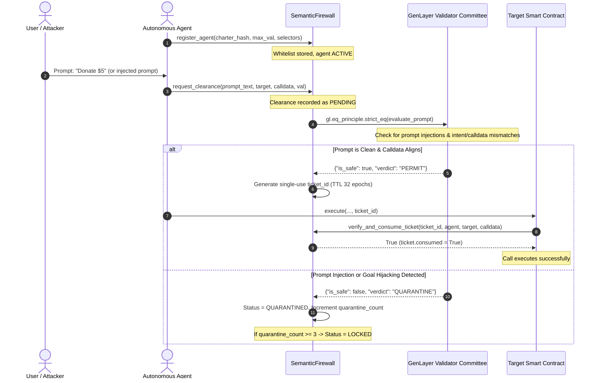

# SemanticFirewall Architecture & Security Model

`SemanticFirewall` is an on-chain prompt injection and execution firewall designed for autonomous AI agents operating on GenLayer.

Autonomous agents managing smart contract treasuries or protocol operations receive natural language triggers from users, external webhooks, or off-chain LLM loops. Attackers can exploit these agents via indirect prompt injections (jailbreaks, context escapes, roleplay manipulation) to coerce the agent into signing transactions that drain funds.

Because traditional smart contracts only verify cryptographic ECDSA signatures or `onlyOwner`, they execute malicious instructions blindly. `SemanticFirewall` introduces an on-chain semantic circuit-breaker: downstream contracts gate sensitive methods behind valid, single-use execution tickets issued only when GenLayer validator consensus confirms that the trigger prompt is benign and matches the intended calldata.

---

## 1. System Components & Flow

---

## 2. Invariants & Security Guarantees

1. **Atomic Single-Use Consumption (Anti-Replay):**
   - An issued `ticket_id` can be redeemed exactly once.
   - Calling `verify_and_consume_ticket` checks `ticket.consumed is False` and atomically sets it to `True`. Any subsequent replay attempt reverts with `UserError`.

2. **Strict Epoch-Based TTL (`TICKET_TTL_EPOCHS = 32`):**
   - Tickets are strictly ephemeral. If a ticket is not consumed within 32 epochs of issuance, it permanently expires and cannot be redeemed.

3. **Circuit-Breaker Quarantine (`MAX_QUARANTINE_TOLERANCE = 3`):**
   - If an agent generates 3 quarantined requests (indicating persistent prompt injection attacks or model compromise), the firewall automatically switches the agent state to `LOCKED`.
   - While `LOCKED`, all further clearance requests revert until the human owner manually calls `unlock_agent()`.

4. **Fail-Closed Consensus Disagreement (`DISPUTE_REJECTED`):**
   - If validator LLMs disagree on prompt safety or if execution times out, the firewall transitions the request to `DISPUTE_REJECTED`.
   - No execution ticket is generated, preventing ambiguous transactions from executing downstream.
